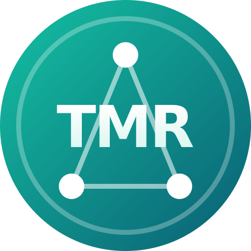

# TMR · Token Multirrede



TRC-20 token on Tron. **Contract:** `TR7NKZVUjuK6udGYNPoCAwpsshD8fhLj6t`

> ⚠️ The address starts like USDT's (`TR7N…`). TMR is `TR7NKZ…Lj6t` — always check the full address.

| | |
|---|---|
| Website | https://tmr-token.vercel.app |
| Whitepaper | https://tmr-token.vercel.app/whitepaper |
| Tronscan | https://tronscan.org/#/token20/TR7NKZVUjuK6udGYNPoCAwpsshD8fhLj6t |
| Pool (SunSwap V4, USDT/TMR, 0.01%) | [sun.io](https://sun.io/?lang=en-US#/scan/pairDetail?pairAddress=f3fa6bae5bf2d64b6b7cd2ae03e08eb63b3eef0b3b5bf45d62888bc04921ab61&version=v4) |
| Telegram | https://t.me/tmr_token |

## Contract

[`src/TokenSimples.sol`](src/TokenSimples.sol) — OpenZeppelin 5.1.0 `ERC20` + `Ownable`.

- Supply: 18,446,744,073,709.551615 TMR, 18 decimals. Supply is already at the cap (`teto`).
- Owner can: mint up to the cap (only possible again after burns), renounce minting forever, change name/symbol, set public info and `contractURI`, transfer ownership.
- **No** blacklist, freeze, pause, transfer tax or power to move other people's tokens. Anyone can burn their own tokens.

TMR is not a stablecoin. Read the risks in the [whitepaper](https://tmr-token.vercel.app/whitepaper).

## Verify the deployed bytecode yourself

Tronscan's verification form cannot reproduce this build (it has no `via_ir` option), so this repository ships a script that compares the code on-chain with the code compiled here, byte by byte.

Requirements: [Foundry](https://book.getfoundry.sh) and Node.js 18+.

```bash
git clone <this repo> && cd tmr-token
npm install
forge install foundry-rs/forge-std --no-git   # only needed for the tests
forge build
npm run verificar
```

Expected output:

```
on-chain     6295 bytes, sha256 7725ddbf7711c748d7054cc4a033603df1aaacb14101aacf15db5fc471253ff0
IGUAL ✓ o código publicado é exatamente o deste repositório
```

The script reads the runtime code with `eth_getCode` from TronGrid's public JSON-RPC and fills the two positions of the `teto` immutable with the on-chain value (it also checks that value equals the cap). Exact build settings are in [`foundry.toml`](foundry.toml): solc 0.8.24, `via_ir`, optimizer runs 1, EVM `paris`, no metadata hash.

## Tests

```bash
forge test
```

12 tests: unit tests (including minting stops after renouncing and only the owner can edit/mint), fuzzing, and invariants (supply never exceeds the cap; sum of balances equals the supply).

## Brand assets

[`marca/`](marca) — logo (SVG, 512 px, 100 px) and `token.json` (the metadata served at the contract's `contractURI`).

---

### Português

Token TRC-20 na rede Tron, contrato `TR7NKZVUjuK6udGYNPoCAwpsshD8fhLj6t`. Este repositório tem o código-fonte do contrato, os testes e um script (`npm run verificar`) que confere, byte a byte, que o código publicado na rede é o compilado aqui. O TMR não é uma stablecoin: leia os riscos no [whitepaper](https://tmr-token.vercel.app/whitepaper).

License: MIT
